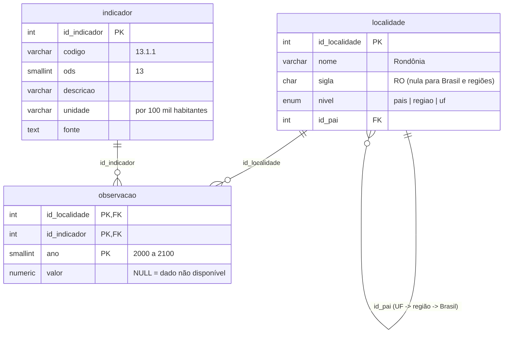

# Documentação do projeto — ODS 13, indicador 13.1.1

Guia para o grupo instalar, rodar, consultar o banco e regenerar os resultados e o artigo.

- **Indicador:** 13.1.1 — número de mortes, pessoas desaparecidas e pessoas diretamente afetadas atribuído a desastres por 100 mil habitantes.
- **Cobertura:** Brasil, 5 Grandes Regiões e 27 UFs, de 2018 a 2024.
- **Fonte:** MI/SEDEC – S2ID; IBGE – estimativas populacionais.

---

## 1. Como o projeto funciona

```text
dados/13-1-1.xlsx              planilha original
        │
        ▼
etl/carregar.py                lê, limpa, valida e grava
        │
        ▼
PostgreSQL (schema ods13)      3 tabelas + 3 views
        │
        ▼
analise/analisar.py            estatística, regressão, gráficos
        │
        ▼
saida/                         tabelas/*.csv, graficos/*.png, resumo.md
        │
        ▼
artigo/montar_artigo.py        preenche o template do Word
        │
        ▼
Artigo_ODS13_Indicador_13-1-1.docx
```

- A **planilha** é a única fonte dos dados. O banco é sempre recriado a partir dela.
- A **análise lê só do banco**, nunca da planilha. Assim, todos os números do artigo saem do PostgreSQL.
- Toda a carga acontece numa **única transação**. Se a planilha tiver erro, o banco continua como estava.

### Estrutura de pastas

| Caminho | O que é |
|---|---|
| `dados/13-1-1.xlsx` | Planilha original do indicador |
| `sql/01_schema.sql` | Cria o schema `ods13` e as tabelas (recria a cada carga) |
| `sql/02_seed_localidades.sql` | Cadastra Brasil, regiões e UFs com siglas e hierarquia |
| `sql/03_views.sql` | Views de consulta e de estatística descritiva |
| `ods13/db.py` | Conexão com o banco (lê `.env`) |
| `ods13/etl.py` | Leitura, limpeza, validação e gravação da planilha |
| `ods13/estatistica.py` | Média, mediana, classe modal, variância, desvio, regressão |
| `ods13/graficos.py` | Gráficos PNG (300 dpi) |
| `ods13/relatorio.py` | Gera CSVs, gráficos e `resumo.md` |
| `ods13/formatacao.py` | Números no padrão brasileiro (`1.213,79`) |
| `etl/carregar.py` | **Comando 1:** carrega a planilha no banco |
| `analise/analisar.py` | **Comando 2:** gera a pasta `saida/` |
| `artigo/montar_artigo.py` | **Comando 3:** preenche o template do artigo |
| `tests/` | Testes automáticos (pytest) |
| `docs/superpowers/` | Design e plano de implementação do projeto |
| `saida/` | Resultados gerados (não vai para o git; é recriada pelos comandos) |

---

## 2. Instalação (uma vez por computador)

Pré-requisitos: **Python 3.13** (com "Add to PATH" marcado na instalação) e **PostgreSQL 18**. O `psql` fica em `C:\Program Files\PostgreSQL\18\bin\psql.exe` e não está no PATH.

### Forma rápida: `setup.ps1`

Depois de clonar o repositório, rode na pasta do projeto:

```powershell
powershell -ExecutionPolicy Bypass -File .\setup.ps1 -Carregar
```

O script pede a senha do usuário `postgres` e faz tudo sozinho:

| Passo | O que faz | Se já existir |
|---|---|---|
| 1 | Cria o `.venv` e instala o `requirements.txt` | Só atualiza as dependências |
| 2 | Testa a conexão com o PostgreSQL | Para com mensagem clara se a senha estiver errada |
| 3 | Cria o `.env` com a senha informada | Não mexe no `.env` existente |
| 4 | Cria os bancos `ods13` e `ods13_teste` | Pula o banco |
| 5 | Com `-Carregar`: roda a carga e a análise, gerando `saida/` | — |

Pode ser rodado de novo sem problema. Sem `-Carregar`, ele só prepara o ambiente. Outras opções: `-Usuario`, `-Servidor` e `-Porta`, para um PostgreSQL diferente do padrão (`postgres@localhost:5432`).

### Forma manual (o que o script faz por dentro)

```powershell
# 1. Ambiente Python do projeto
python -m venv .venv
.venv\Scripts\python -m pip install -r requirements.txt

# 2. Bancos de dados (pede a senha do usuário postgres)
& "C:\Program Files\PostgreSQL\18\bin\psql.exe" -U postgres -h localhost -c "CREATE DATABASE ods13 ENCODING 'UTF8' TEMPLATE template0"
& "C:\Program Files\PostgreSQL\18\bin\psql.exe" -U postgres -h localhost -c "CREATE DATABASE ods13_teste ENCODING 'UTF8' TEMPLATE template0"

# 3. Configuração da conexão
copy config.example.env .env
# abra o .env e troque SUA_SENHA pela senha do postgres (nas duas linhas)
```

O `.env` fica fora do git. Cada pessoa do grupo cria o seu com a própria senha.

| Banco | Para quê |
|---|---|
| `ods13` | Banco principal: dados usados no artigo |
| `ods13_teste` | Usado só pelos testes, que o apagam e recriam |

### VS Code

O projeto já traz `.vscode/settings.json` apontando para `.venv`. Se o botão ▷ der `ModuleNotFoundError: No module named 'sqlalchemy'`, o VS Code está usando outro Python: `Ctrl+Shift+P` → **Python: Select Interpreter** → `.\.venv\Scripts\python.exe` e abra um terminal novo.

---

## 3. Rodar o projeto

Sempre nesta ordem, a partir da pasta `ODS13`:

```powershell
.venv\Scripts\python etl\carregar.py          # 1. planilha -> banco
.venv\Scripts\python analise\analisar.py      # 2. banco -> saida\
.venv\Scripts\python artigo\montar_artigo.py  # 3. saida\ -> artigo .docx (feche o .docx no Word antes)
```

Saída esperada do passo 1:

```
231 linhas carregadas em ods13.observacao.
4 valores sem dado ("..." -> NULL):
  - Tocantins 2019
  - Paraíba 2018
  - Sergipe 2018
  - Distrito Federal 2018
```

### O que o passo 2 gera em `saida/`

| Arquivo | Conteúdo | Uso no artigo |
|---|---|---|
| `tabelas/descritiva_por_ano.csv` | n, ausentes, média, mediana, variância, desvio, mín., máx., classe modal — entre UFs, por ano | Resultados 5.1 (Tabela 2) |
| `tabelas/descritiva_por_localidade.csv` | As mesmas medidas para Brasil, cada região e cada UF | Resultados 5.1 (Tabela 1) |
| `tabelas/regressoes.csv` | a, b, b com ano − 2018, r, r², p-valor, n | Resultados 5.2 (Tabela 3) |
| `tabelas/observacoes.csv` | Dados em formato largo | Anexo B |
| `graficos/*.png` | 11 gráficos: evolução, médias, histograma, dispersões | Figuras 1 a 6 |
| `resumo.md` | Números prontos para copiar no texto | Todo o artigo |

Os CSVs usam `;` e vírgula decimal e abrem direto no Excel em português.

### Testes

```powershell
.venv\Scripts\python -m pytest
```

Devem passar 40 testes. Eles usam o banco `ods13_teste` e conferem os números contra valores calculados à mão (por exemplo, média do Brasil = 526,67 e inclinação da reta = 58,20).

---

## 4. Modelo de dados



| Objeto | Linhas | Descrição |
|---|---|---|
| `ods13.localidade` | 33 | 1 país, 5 regiões, 27 UFs |
| `ods13.indicador` | 1 | Indicador 13.1.1 |
| `ods13.observacao` | 231 | 33 localidades × 7 anos (4 valores NULL) |
| `ods13.vw_observacao` | 231 | Junção legível: nome, sigla, nível, região, ano, valor |
| `ods13.vw_descritiva_ano_uf` | 7 | Estatística entre as 27 UFs, por ano |
| `ods13.vw_descritiva_localidade` | 33 | Estatística de cada localidade, 2018–2024 |

**Regras importantes:**
- `...` na planilha vira `NULL`, nunca zero. `0` na planilha é valor real.
- Estatística "entre UFs" usa só `nivel = 'uf'`. Brasil e regiões já são somas das UFs, por isso não entram juntos.
- Variância e desvio padrão são **amostrais** (`VAR_SAMP`, `STDDEV_SAMP`).

---

## 5. Consultar o banco

### 5.1 Pelo psql (terminal)

```powershell
& "C:\Program Files\PostgreSQL\18\bin\psql.exe" -U postgres -h localhost -d ods13
```

Comandos úteis dentro do psql:

| Comando | Faz |
|---|---|
| `\dt ods13.*` | Lista as tabelas |
| `\dv ods13.*` | Lista as views |
| `\d+ ods13.observacao` | Mostra colunas e comentários de uma tabela |
| `\x` | Alterna a exibição em colunas / em registros |
| `\q` | Sai |

Se os acentos aparecerem quebrados no terminal do Windows, rode antes `chcp 65001` ou use o pgAdmin.

### 5.2 Pelo pgAdmin

1. Abra o pgAdmin 4 e conecte em **PostgreSQL 18** com a senha do `postgres`.
2. Navegue: **Databases → ods13 → Schemas → ods13 → Tables / Views**.
3. Para ver dados: clique com o botão direito na tabela ou view → **View/Edit Data → All Rows**.
4. Para rodar SQL: selecione o banco `ods13` → **Tools → Query Tool**, cole a consulta e aperte `F5`.

Os prints do pgAdmin servem para os Anexos do artigo.

### 5.3 Consultas prontas

```sql
-- Série de uma UF (troque a sigla)
SELECT nome, regiao, ano, valor
FROM ods13.vw_observacao
WHERE sigla = 'RS'
ORDER BY ano;

-- Série do Brasil
SELECT ano, valor FROM ods13.vw_observacao WHERE nome = 'Brasil' ORDER BY ano;

-- Estatística descritiva entre as UFs, por ano
SELECT ano, n, ausentes,
       round(media, 2)                 AS media,
       round(mediana::numeric, 2)      AS mediana,
       round(variancia, 2)             AS variancia,
       round(desvio_padrao, 2)         AS desvio_padrao
FROM ods13.vw_descritiva_ano_uf;

-- As 5 UFs com maior média no período
SELECT nome, round(media, 2) AS media
FROM ods13.vw_descritiva_localidade
WHERE nivel = 'uf'
ORDER BY media DESC
LIMIT 5;

-- Estatística do Brasil e das regiões
SELECT nome, round(media, 2) AS media, round(mediana::numeric, 2) AS mediana,
       round(desvio_padrao, 2) AS desvio_padrao, minimo, maximo
FROM ods13.vw_descritiva_localidade
WHERE nivel IN ('pais', 'regiao');

-- Valores sem dado na planilha
SELECT l.nome, o.ano
FROM ods13.observacao o
JOIN ods13.localidade l USING (id_localidade)
WHERE o.valor IS NULL;

-- Quantas UFs há em cada região (confere a hierarquia)
SELECT r.nome AS regiao, count(*) AS ufs
FROM ods13.localidade u
JOIN ods13.localidade r ON r.id_localidade = u.id_pai
WHERE u.nivel = 'uf'
GROUP BY r.nome
ORDER BY r.nome;

-- Regressão linear direto no SQL (confere o resultado do Python: a = 58,20 e r = 0,363)
SELECT round(regr_slope(valor, ano)::numeric, 2)     AS a,
       round(regr_intercept(valor, ano)::numeric, 2) AS b,
       round(corr(valor, ano)::numeric, 3)           AS r
FROM ods13.vw_observacao
WHERE nome = 'Brasil';
```

### 5.4 Pelo Python

```python
from ods13.db import criar_engine, url_do_ambiente
from ods13.estatistica import carregar_observacoes, descritiva_por_ano, regressoes

engine = criar_engine(url_do_ambiente())          # usa o DATABASE_URL do .env
df = carregar_observacoes(engine)                 # DataFrame da vw_observacao
print(descritiva_por_ano(df))                     # tabela por ano (entre UFs)
for r in regressoes(df):
    print(r.serie, round(r.a, 2), round(r.r, 3))

import pandas as pd
pd.read_sql("SELECT * FROM ods13.vw_descritiva_localidade", engine)   # qualquer SQL
```

Rode com `.venv\Scripts\python` a partir da pasta `ODS13`.

---

## 6. Tarefas comuns

### Atualizar os dados (nova planilha)

1. Substitua `dados/13-1-1.xlsx` pela nova versão, com o mesmo formato: título, cabeçalho com os anos, uma linha por localidade e a linha de fonte no fim.
2. Se mudarem os anos ou a quantidade de células `...`, ajuste `ANOS` e `nulos_esperados` em `ods13/etl.py`. Senão a carga para com uma mensagem explicando a diferença.
3. Rode os três comandos da seção 3.
4. Revise os textos do artigo em `artigo/montar_artigo.py`: os trechos que citam números fixos precisam ser conferidos com o novo `saida/resumo.md`.

### Gerar o artigo de novo

Feche o `.docx` no Word e rode `.venv\Scripts\python artigo\montar_artigo.py`. O script parte sempre do template original (`Template_Artigo_Cientifico_Projeto_ODS (1).docx`). **Edições feitas à mão no artigo gerado se perdem.** Por isso, ou edite o texto no script, ou só edite o `.docx` à mão quando não for gerá-lo de novo.

### Conferir um número do artigo

Todo número vem de `saida/resumo.md` ou dos CSVs. Para conferir no banco, use as consultas da seção 5.3.

---

## 7. Problemas comuns

| Mensagem | Causa | Solução |
|---|---|---|
| `ModuleNotFoundError: No module named 'sqlalchemy'` | VS Code ou terminal usando outro Python | Use `.venv\Scripts\python` ou selecione o interpretador (seção 2) |
| `Defina DATABASE_URL no arquivo .env` | Falta o `.env` | `copy config.example.env .env` e preencha a senha |
| `Não foi possível conectar ao PostgreSQL` | Senha errada no `.env` ou serviço parado | Confira a senha; em **Serviços do Windows**, inicie `postgresql-x64-18` |
| `O banco ainda não tem os dados. Rode primeiro: python etl/carregar.py` | Análise antes da carga | Rode o passo 1 |
| `Localidades não cadastradas…` / `Localidades ausentes…` | Nome diferente ou linha faltando na planilha | Corrija o nome para ficar igual ao de `sql/02_seed_localidades.sql` |
| `Valor inválido em <UF> <ano>` | Célula com texto, como `1.234,5` | Use ponto decimal (`1234.5`) ou `...` |
| `Esperados 4 valores nulos…` / `Anos esperados…` | Planilha nova com outro formato | Ajuste `nulos_esperados` / `ANOS` em `ods13/etl.py` |
| `Não foi possível gravar Artigo…docx` | Artigo aberto no Word | Feche o arquivo e rode de novo |
| Acentos quebrados no psql | Codificação do terminal | `chcp 65001` ou use o pgAdmin |

---

## 8. Decisões do projeto

- **PostgreSQL em vez de MySQL:** o template cita MySQL, mas o grupo escolheu PostgreSQL, que calcula mediana e regressão direto no SQL. Na Metodologia do artigo isso já está explicado.
- **Moda:** os valores quase não se repetem, então o artigo usa a **classe modal** (regra de Sturges) e informa também a moda bruta (0,0, com 5 ocorrências).
- **Regressão:** Y = valor do indicador, X = ano. Ajustada para o Brasil, cada região e todas as UFs juntas. As séries têm só 7 anos, então as tendências são pouco robustas. A regressão com as UFs juntas trata anos da mesma UF como independentes e serve só como análise complementar.
- Design completo: `docs/superpowers/specs/2026-11-15-ods13-indicador-13-1-1-design.md`.
